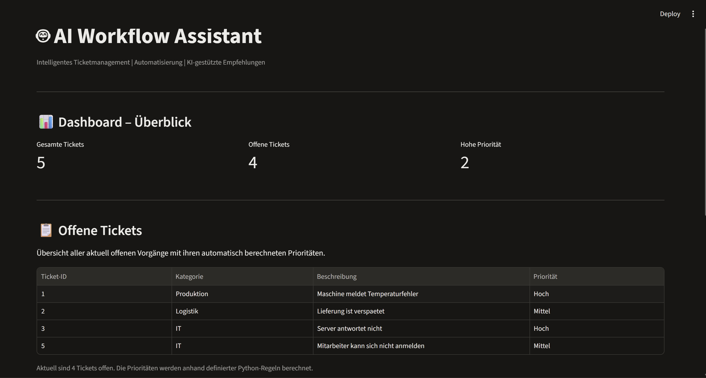
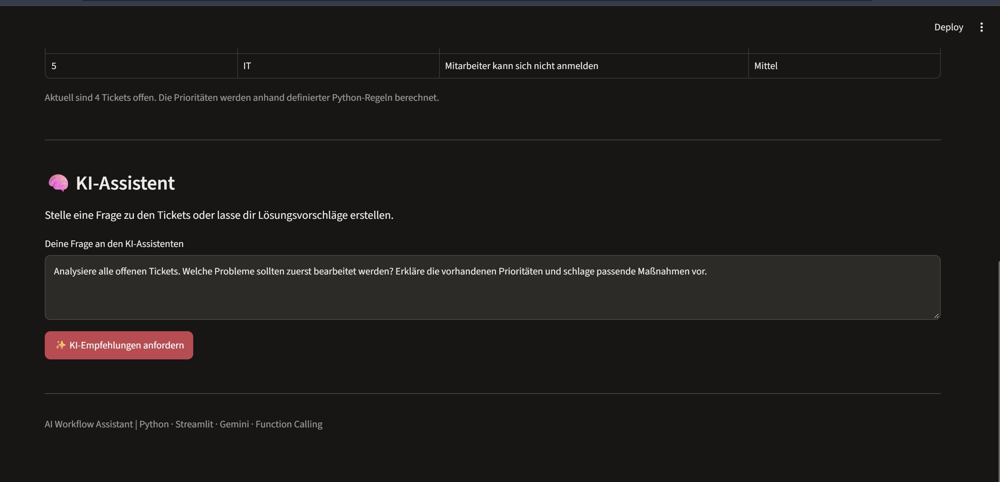

# 🤖 AI Workflow Assistant

An AI-powered ticket management application built with
Python, Streamlit, Google Gemini and Docker.

The application analyzes operational tickets, calculates
rule-based priorities and generates AI-powered explanations
and recommended actions.

## 📸 Screenshots

### Dashboard



### AI Analysis and Recommendations



## 🚀 Features

- Interactive ticket dashboard built with Streamlit
- Overview of open tickets and their priorities
- Rule-based ticket prioritization
- Ticket statistics by category
- AI-powered explanations and recommendations
- Google Gemini Function Calling with Python tools
- Automatic Markdown report generation
- Downloadable AI analysis reports
- Automated unit tests
- Docker containerization
- Command-line ticket analysis

## 🛠️ Tech Stack

- **Python** – Backend logic and data processing
- **Streamlit** – Interactive web interface
- **Google Gemini API** – AI-powered recommendations
- **Function Calling** – AI integration with Python functions
- **Docker** – Containerization and deployment
- **CSV** – Ticket data storage
- **unittest** – Automated testing
- **Git & GitHub** – Version control

## 📁 Project Structure

```text
ai-workflow-assistant/
├── app.py
├── main.py
├── ai_client.py
├── tools.py
├── data/
│   └── tickets.csv
├── tests/
│   └── test_tools.py
├── requirements.txt
├── Dockerfile
├── .dockerignore
├── .gitignore
├── .env.example
├── image.png
├── image-1.png
└── README.md
```

### Main Files

| File | Description |
|---|---|
| `app.py` | Streamlit web application with Gemini integration |
| `main.py` | Command-line ticket analysis |
| `ai_client.py` | Standalone Gemini API and Function Calling example |
| `tools.py` | Reusable analysis and prioritization functions |
| `tickets.csv` | Fictional ticket data |
| `test_tools.py` | Automated unit tests |
| `Dockerfile` | Instructions for building the Docker image |

## 🧠 How It Works

1. Python reads the ticket data from a CSV file.
2. The application identifies open tickets.
3. Python functions calculate ticket statistics and priorities.
4. Gemini selects the appropriate Python tools using Function Calling.
5. The AI explains priorities and suggests possible solutions.
6. Results are displayed in the Streamlit dashboard.
7. The analysis can be exported as a Markdown report.

### AI + Rule-Based Logic

The application combines traditional software engineering
with generative AI.

**Python handles:**
- Reading and filtering tickets
- Calculating exact statistics
- Applying predefined priority rules

**Gemini handles:**
- Understanding natural language questions
- Selecting appropriate Python tools
- Explaining ticket priorities
- Generating recommended actions

This hybrid approach provides more control over ticket
priorities while allowing flexible AI-assisted analysis.

## 💻 Installation

### 1. Clone the Repository

```bash
git clone https://github.com/OMoumni/ai-workflow-assistant.git
cd ai-workflow-assistant
```

### 2. Create a Virtual Environment

```bash
python -m venv .venv
```

Activate on Windows:

```powershell
.\.venv\Scripts\Activate.ps1
```

### 3. Install Dependencies

```bash
python -m pip install -r requirements.txt
```

### 4. Configure the API Key

Create a `.env` file in the project directory:

```dotenv
GEMINI_API_KEY=your_api_key_here
```

Get your API key from:

https://aistudio.google.com/api-keys

Never commit your real API key to GitHub.

## ▶️ Run the Application

Start the Streamlit application:

```bash
python -m streamlit run app.py
```

Open:

http://localhost:8501

### Command-Line Version

```bash
python main.py
```

### Gemini Function Calling Example

```bash
python ai_client.py
```

## 🐳 Docker

The application can be run in a Docker container without
installing Python and its dependencies directly on the host.

### Build the Docker Image

```bash
docker build -t ai-workflow-assistant .
```

### Run the Docker Container

Create your local `.env` file first.

```bash
docker run --rm -p 8501:8501 --env-file .env ai-workflow-assistant
```

Then open:

http://localhost:8501

The Gemini API key is passed to the container at runtime
and is not included in the Docker image.

## 🧪 Testing

Run the automated tests:

```bash
python -m unittest discover -s tests -v
```

The tests verify ticket statistics and rule-based priorities.

## 📊 Example

**User question:**

> Which open tickets should be handled first?

**Example AI response:**

**Ticket:** Server antwortet nicht

**Priority:** High

**Reason:** A server outage can interrupt business-critical systems.

**Recommendation:** Check server availability, network connections,
and system logs.

The AI uses the priority calculated by the Python functions.

## 🔐 Security

- API credentials are stored locally in `.env`.
- `.env` is excluded from Git and Docker builds.
- Only fictional sample tickets are included.
- AI recommendations should be reviewed by humans.

## ⚠️ Limitations

- Ticket data is currently stored in a CSV file.
- Priorities use predefined rules.
- AI-generated recommendations may be inaccurate.
- Gemini requires internet access and an API key.
- The application currently runs locally.

## 🔮 Future Improvements

- Database integration
- Ticket creation and editing
- User authentication
- Additional AI tools
- Cloud deployment

## 👨‍💻 Author

**Omar Moumni**

Computer Science Student

GitHub: https://github.com/OMoumni

Portfolio: https://omoumni.github.io/omar-portfolio/
